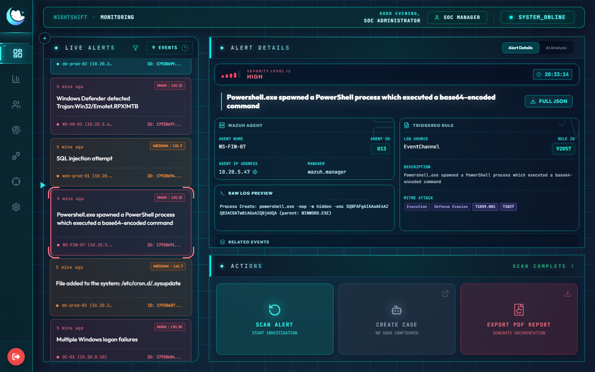
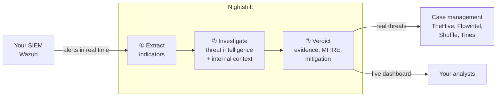
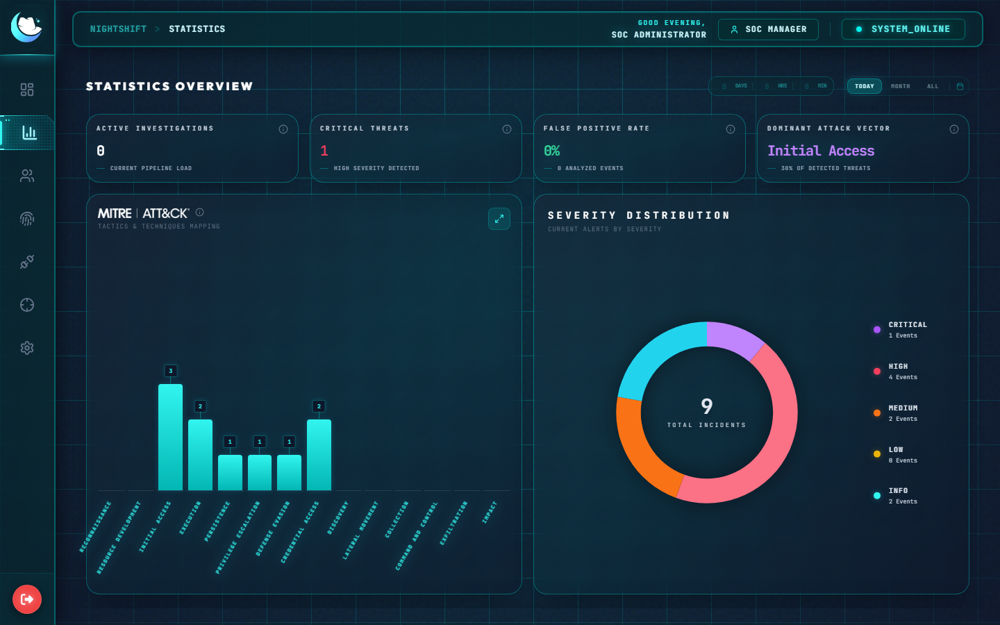
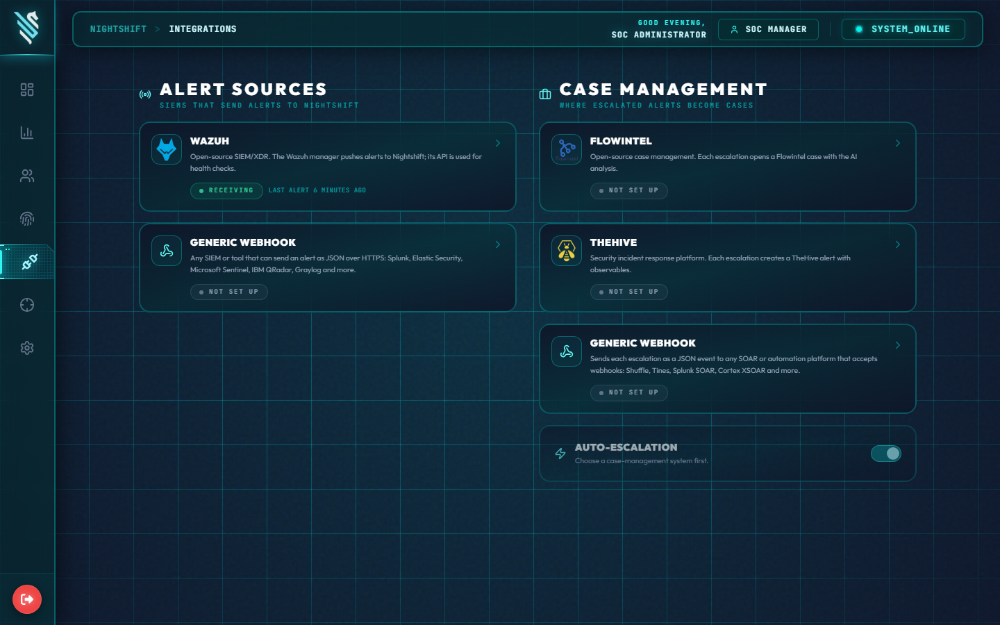
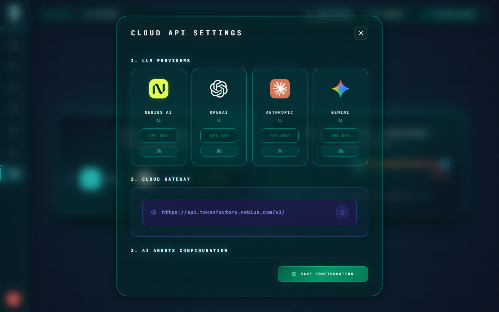
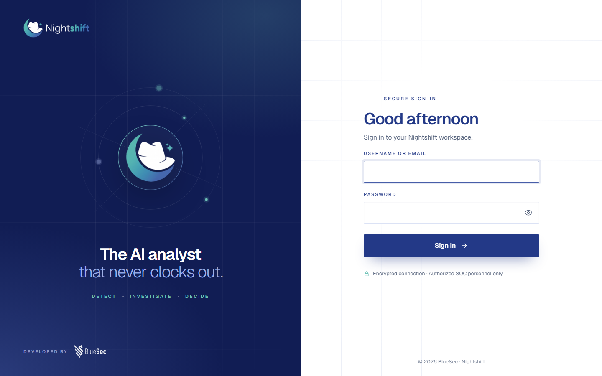

<div align="center">

# Nightshift

### The AI analyst that never clocks out.

Nightshift triages every security alert the moment it fires: it investigates like an
experienced SOC analyst, delivers a clear verdict with the evidence behind it, and
escalates the real threats to your team.




</div>

---

## Why Nightshift

Security teams drown in alerts. Most are noise, and the few that matter wait in the
queue behind them. Nightshift does the first pass of every investigation for you,
around the clock, so analysts spend their time on real incidents.

| | |
|---|---|
| **⚡ Instant triage** | Every alert is analyzed within seconds of arriving, nights and weekends included. |
| **🔍 Real investigations** | Indicators are extracted, checked against threat intelligence and compared with your own environment's history before any conclusion is drawn. |
| **⚖️ Clear verdicts** | *Malicious*, *Suspicious* or *False Positive*, with a confidence score, the key evidence, MITRE ATT&CK mapping and recommended mitigation steps. |
| **🚨 Automatic escalation** | Confirmed threats become cases in your case-management system, with the full analysis attached. |
| **🔒 Your data stays yours** | Runs on your own server. Use a local AI model and nothing leaves your network. No telemetry. |

## How it works



1. **Extract**: an AI agent reads the raw alert and pulls out every indicator: IP
   addresses, domains, URLs, file hashes, accounts, processes.
2. **Investigate**: each indicator is checked with your threat-intelligence services
   and against your own data (how often this rule fires, on which hosts).
3. **Verdict**: a second AI agent weighs all the evidence and decides, explaining its
   reasoning in plain language.

You choose which alerts are analyzed automatically (for example, severity 7 and above).
Analysts can investigate any other alert with one click.

## A closer look

<table>
<tr>
<td width="50%"><br/><b>Statistics</b><br/>Severity distribution, MITRE ATT&CK coverage and the dominant attack vectors at a glance.</td>
<td width="50%"><br/><b>Integrations</b><br/>Connect your SIEM and case-management system from the interface, with step-by-step guides and live status.</td>
</tr>
<tr>
<td width="50%"><br/><b>Your choice of AI</b><br/>Use a cloud AI provider or run a model on your own hardware. Switch at any time.</td>
<td width="50%"><br/><b>Secure access</b><br/>Built-in sign-in with roles for SOC managers and L1 to L3 analysts.</td>
</tr>
</table>

**Also included:** a live alert feed, one-click PDF investigation reports, user and
role management, a sign-in activity log, and automatic escalation rules.

## Works with your tools

| | |
|---|---|
| **SIEM** | Wazuh |
| **Case management** | TheHive and Flowintel (native connectors), plus automation platforms that receive a webhook, such as Shuffle or Tines |
| **AI models** | Nebius AI, OpenAI, Anthropic, Google Gemini, any OpenAI-compatible service, or a local model (Ollama, vLLM) |
| **Threat intelligence** | VirusTotal, AbuseIPDB, URLScan, AlienVault OTX, Hybrid Analysis, GreyNoise, Shodan, ThreatFox, MxToolbox, EmailRep, NVD, and your own sources |

## Deployment

Nightshift runs on a single Linux server in your environment. Analysts use it from
their browser: nothing to install on their machines.

**You need:** a Linux server (Ubuntu, Debian or RHEL family) with Docker, 4 CPU cores,
8 GB of memory and 40 GB of disk.

**Installing takes one command.** The installer checks the server, sets everything up
with unique passwords, creates a certificate and the first administrator account, then
prints the address to open:

```bash
sudo ./install.sh --url https://soc.your-company.local
```

Two delivery options:

- **Full package**: everything included. Installs without internet access, ideal for
  isolated networks.
- **Small package**: a few kilobytes; the application is downloaded during installation
  with a personal account.

Upgrades take one command too. A backup is taken first, and if anything goes wrong the
previous version is restored automatically.

## Security and privacy

- **Encrypted secrets**: API keys and passwords are encrypted in the database and never
  shown again once saved.
- **Controlled access**: sign-in with roles, automatic lockout after repeated failed
  attempts, administrative functions for SOC managers only.
- **Encrypted traffic**: HTTPS everywhere, and each alert source has its own revocable
  access token.
- **Minimal data sharing**: only public indicators are sent to threat-intelligence
  services, and only to the services you enable. With a local AI model, alert data
  never leaves your network.
- **No telemetry**: Nightshift never reports back to anyone.

The full details for security reviews are in [Data flows and security](docs/DATA-FLOWS.md).

## Documentation

| Guide | For |
|---|---|
| [Installation](docs/INSTALL.md) | Installing Nightshift and connecting it to your environment |
| [Administration](docs/ADMIN.md) | Day-to-day operation, users, backups |
| [Upgrading](docs/UPGRADE.md) | Upgrades, restores and moving to a new server |
| [Data flows and security](docs/DATA-FLOWS.md) | What is sent where, and how it is protected |
| [Connecting Wazuh](deploy/wazuh-connector/README.md) | Setting up the Wazuh integration |
| [Development](DEVELOPMENT.md) | Working on the Nightshift code |

---

<div align="center">
<sub>Proprietary software, developed by BlueSec. All rights reserved.</sub>
</div>
